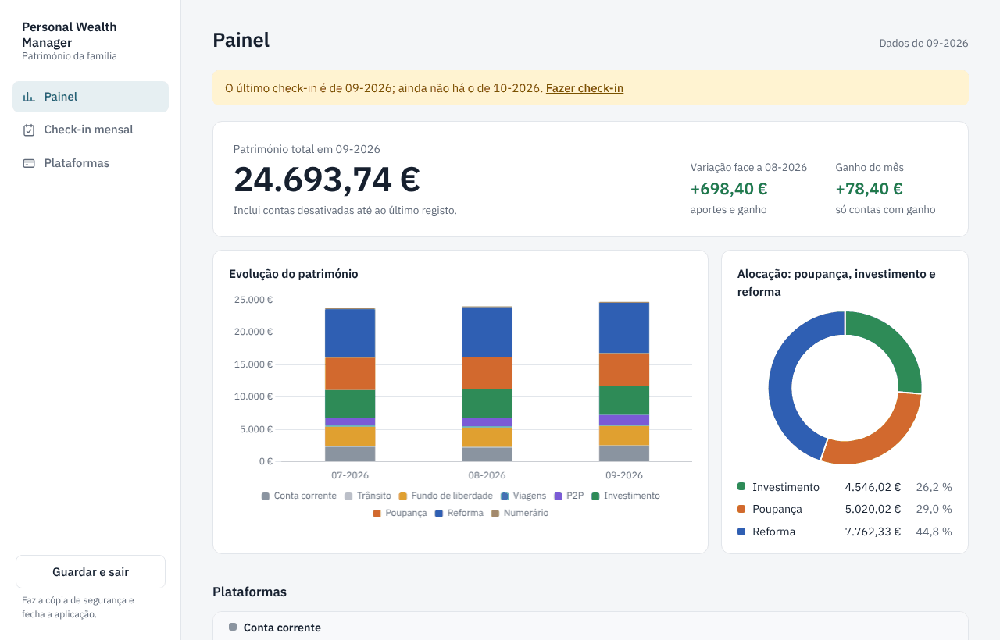
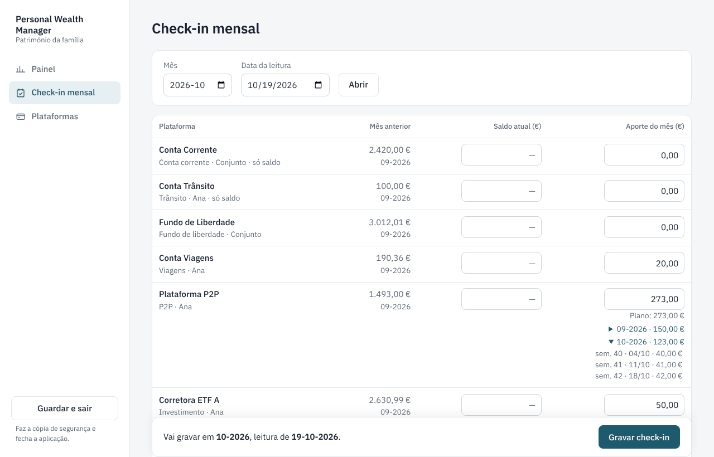
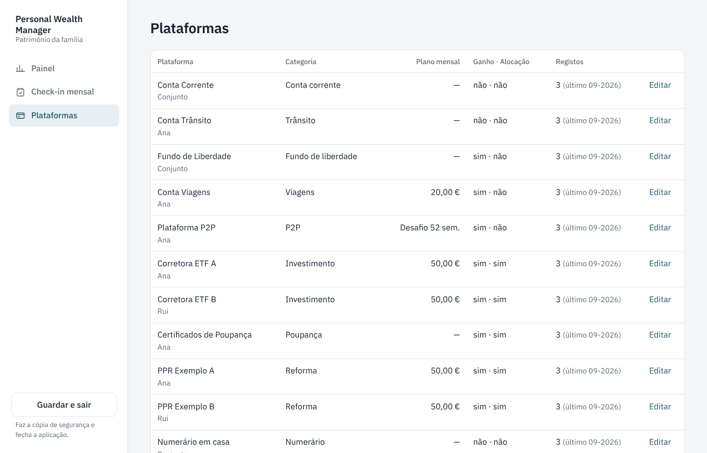
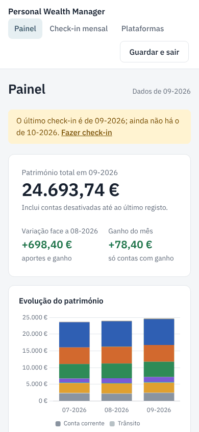

# Personal Wealth Manager (PWM)

Aplicação **local e offline** para acompanhar o património pessoal. No início de cada mês atualizas os saldos
num único ecrã e vês logo o resultado (ganho do mês, avisos), sem passar por folhas de cálculo.

Os dados ficam na tua máquina, numa base de dados SQLite. Não há contas, nem serviços externos, nem CDN.

> **Estado:** versão 1 completa: painel, check-in mensal, gestão de plataformas, cópia de segurança e restauro,
> com o design final. Em uso desde outubro de 2026. Versão 2 em curso: cobertura do fundo de liberdade e registo
> dos depósitos do Desafio das 52 semanas feitos; a seguir, metas de poupança e comparação com índices.



| Check-in mensal | Plataformas | Janela estreita |
|---|---|---|
|  |  |  |

As capturas usam os dados fictícios da demonstração (ver abaixo).

## O que já faz

- **Painel** (`/`): património total, variação face ao mês anterior e ganho do mês; evolução do património
  em linha (total, categorias na legenda, filtro "Este ano" / "Desde o início"), alocação (poupança, investimento, reforma), a lista das plataformas agrupada por categoria
  (saldo, ganho, aporte real vs plano), a cobertura do fundo de liberdade (quantos meses de despesas paga,
  com a despesa mensal de referência editável no próprio painel) e o progresso do Desafio das 52 semanas
  (confirmados, em falta e por confirmar). Gráficos com Chart.js guardado
  localmente.
- **Check-in mensal** (`/checkin`): uma linha por plataforma, com o saldo do mês anterior só como
  referência e o aporte pré-preenchido pelo plano (no Desafio das 52 semanas, uma caixa por domingo em
  aberto, agrupadas por mês). Grava tudo ou nada, e mostra o ganho do mês e os avisos
  logo a seguir. Regravar um mês atualiza-o, não duplica.
- **Plataformas** (`/plataformas`): criar, editar, desativar e reativar (com o plano mensal ou o Desafio das
  52 semanas). Só se desativa uma conta fechada: primeiro grava-se no check-in o saldo 0, com o levantamento
  como aporte negativo (e o mesmo valor como aporte no destino). O histórico fica no painel. Só se apaga uma
  plataforma sem registos.
- **Categorias** (no mesmo ecrã): criar, renomear e apagar. Renomear não mexe no histórico; nomes iguais sem
  contar maiúsculas nem acentos são recusados; só se apaga uma categoria sem plataformas, e a do fundo de
  liberdade nunca se apaga (é a base da cobertura em meses).
- **Ganho do mês** = saldo − saldo do mês anterior − aporte. Plataformas como contas correntes ou
  numerário (onde salários e transferências não são lucro) ficam só com saldo, sem ganho.
- **Avisos**: ganho negativo e mês em falta.
- **Desafio das 52 semanas**: plano de depósitos semanais (1 €, 2 €, … 52 €, ao domingo). No check-in, cada
  domingo em aberto tem uma caixa: marcados entram no aporte e ficam registados como depositados; um domingo
  desmarcado volta no check-in seguinte ("em atraso"). Depois de gravar, a app avisa se o rendimento
  anualizado sair de uma faixa plausível (3–8 %) ou se o aporte não bater com as caixas marcadas.
- **Cópia de segurança** em CSV (`;`, UTF-8 com BOM, abre direto no Excel): no arranque, depois de cada
  gravação e no botão "Guardar e sair". Nunca sobrescreve, não duplica cópias iguais, mantém as 30 mais
  recentes e a última de cada mês.
- **Restauro** para uma base nova ao lado, sem tocar na atual, com validação dos dados.
- **Formatos portugueses no ecrã:** valores em `1.234,56 €`, meses em `09-2026`, datas em `19-10-2026`.
- **Ecrãs que se adaptam** a janelas estreitas (a captura "Janela estreita" mostra a mesma página com 390 px de
  largura). O servidor só aceita pedidos da própria máquina, por isso a app não se abre noutro dispositivo.

## Decisões de desenho

- **Dinheiro em cêntimos inteiros** em toda a aplicação, nunca `float`.
- **A base de dados vive fora de pastas sincronizadas** (OneDrive e semelhantes): o SQLite em pastas
  sincronizadas pode corromper-se, e o código recusa abrir um `.db` aí.
- **O saldo anterior nunca vem pré-preenchido**, para não gravar por engano um valor antigo.
- A lógica de dinheiro está fora da camada web (`app/checkin.py`, `app/calc.py`, `app/dashboard.py`) e é
  testável sem servidor.
- **Só aceita pedidos da própria máquina:** o servidor escuta em `127.0.0.1`, recusa outros `Host`
  (DNS rebinding) e recusa formulários submetidos a partir de outros sites (CSRF).

## Instalação (Windows)

Desenvolvido e testado com Python 3.14.

```powershell
python -m venv "$env:LOCALAPPDATA\pwm\venv"
& "$env:LOCALAPPDATA\pwm\venv\Scripts\Activate.ps1"
pip install -r requirements.txt
```

O ambiente virtual fica fora da pasta do projeto, onde o `scripts\pwm.bat` o procura.

## Utilização

```powershell
scripts\pwm.bat
```

Faz a cópia de segurança do estado anterior, arranca o servidor em `http://127.0.0.1:8000` e abre o browser.
Para fechar, usa o botão **Guardar e sair** da aplicação. Faz a cópia de segurança mas não grava formulários:
se houver valores escritos e por gravar (check-in, despesa mensal ou plataforma), pede confirmação antes de sair.

A base de dados fica em `%LOCALAPPDATA%\pwm\pwm.db`. Variáveis de ambiente:

| Variável | Para quê |
|---|---|
| `PWM_DB` | caminho de outra base de dados |
| `PWM_BACKUP` | pasta das cópias de segurança (por defeito, `backup\` no projeto) |

### Experimentar com dados de demonstração

A demonstração usa plataformas e valores fictícios, numa base e numa pasta de cópias à parte. O script recusa-se
a correr sem estas duas variáveis, para nunca misturar a demo com dados reais:

```powershell
$env:PWM_DB = "$env:LOCALAPPDATA\pwm\demo.db"
$env:PWM_BACKUP = "$env:LOCALAPPDATA\pwm\demo-backup"
python -m scripts.seed_demo
python -m uvicorn app.main:app
# no fim, na mesma janela:
Remove-Item Env:PWM_DB, Env:PWM_BACKUP
```

### Cópia de segurança e restauro

```powershell
python -m app.backup                                   # cópia manual
python -m app.restauro [cópia] [--destino ficheiro.db] # cria uma base nova, nunca sobrescreve
$env:PWM_DB = "<ficheiro.db>"                          # para usar a base restaurada
```

## Testes

```powershell
pytest
```

Os testes não escrevem na pasta de cópias real: cada teste usa uma pasta temporária.

## Estrutura

```
app/
  main.py        rotas web (FastAPI)
  dashboard.py   lógica do painel, sem web
  checkin.py     lógica do check-in mensal, sem web
  plataformas.py gestão das plataformas, sem web
  calc.py        cálculo do ganho e dos avisos
  planos.py      Desafio das 52 semanas e verificação do rendimento
  configuracao.py valores editáveis na app (despesa mensal de referência)
  db.py          ligação, esquema e migrações (SQLite)
  backup.py      cópia de segurança em CSV
  restauro.py    restauro para uma base nova
  templates/     páginas HTML (Jinja2); base.html tem a barra lateral
  static/        estilo (css/pwm.css), Chart.js e o tipo de letra, tudo local
scripts/
  pwm.bat        arranque no Windows
  seed_demo.py   dados de demonstração
tests/           testes (pytest)
docs/capturas/   capturas de ecrã para este README
```

## Licença

[MIT](LICENSE). Inclui o Chart.js (MIT) e o tipo de letra IBM Plex Sans (SIL Open Font License 1.1,
`app/static/vendor/fonts/OFL-IBM-Plex-Sans.txt`).
